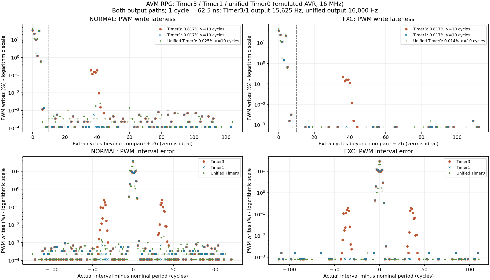
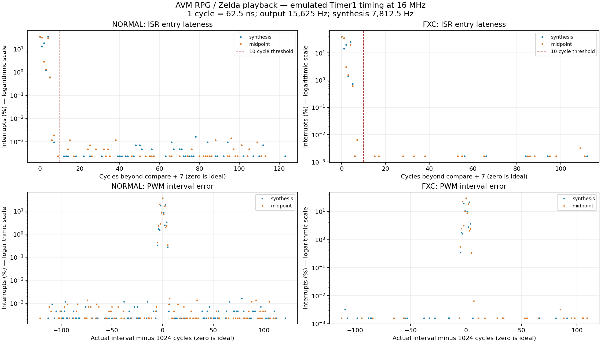

# RPG synthesis interrupt timing experiments

Measured 2026-10-19 using Ardens, unmerged AVR instructions, a 16 MHz CPU,
and RelWithDebInfo builds. These are calibrated emulator measurements; they
exclude physical PLL/carrier jitter, pin transitions and analog speaker behavior.

## Selected implementation

Audio uses **Timer1 COMPA** with prescaler 8 and `OCR1A=127`: **15,625 Hz output**,
with synthesis on alternate interrupts at **7,812.5 Hz**. Timer4 retains its
250 kHz PWM carrier. Timer0 keeps its separate **1 kHz millisecond clock** and
queues one sequencer tick every four milliseconds. Existing millisecond APIs,
frame scheduling, note tuning, channel encoding and interpolation are preserved.
The experimental unified clock, raw timer API and fractional frame scheduler
were removed from the runtime.

Timer1 wins pending interrupt arbitration over Timer0 (vectors 17 and 21).
It does not preempt an already running ISR. In this workload it eliminates the
periodic Timer0 collision pattern while using less CPU than unified Timer0.
Startup clears the Timer0/Timer1 power gates and stops/masks Timer3, including
clearing its speaker-pin ownership. Native tests seed inherited timer settings
and check simultaneous pending Timer0/Timer1 arbitration.

The current packages and [Timer1 data](audio_timing_data/timer1.json) match the
final selected firmware, including the startup fixes. The original Timer1
experiment and unified firmware/packages remain in their named `build` folders.



## Method and definition of zero

The normal run plays 40 seconds of the complete Zelda transcription, then
opens/closes dialogue, navigates menus/status, saves, walks for six seconds,
and pushes against a wall for two seconds. Assertions verify that walking and
collision actually occur. Each normal run covers about 55.1 seconds; FXC runs
eight seconds of playback. Timer3 and selected Timer1 use identical guest bytes.
The unified experiment uses the same score and scenarios with its experimental
runtime scheduler and a 2.4% higher output/synthesis rate (16,000/8,000 Hz).
All package, firmware, guest-image and score hashes are retained in the JSON.

The host-only observer derives compare deadlines from the emulated counter
and shared prescaler and pairs every compare with ISR entry, completed OCR4A
store and RETI. Production firmware contains no timing probes.

- ISR entry lateness = body entry minus compare deadline minus **7 cycles**.
- PWM lateness = completed OCR4A store minus compare deadline minus **26 cycles**.
- PWM interval error = actual store spacing minus the nominal period:
  **1024 cycles** for Timer3/Timer1, **1000 cycles** for unified Timer0.
- Synthesis interval error subtracts twice the corresponding output period.

Zero is the earliest possible update after the fixed interrupt/write path.
The fixed seven cycles are AVR response plus the vector JMP; see
[Microchip's interrupt documentation](https://developerhelp.microchip.com/xwiki/bin/view/products/mcu-mpu/8-bit-avr/structure/interrupts/).
One cycle is 62.5 ns. Every observed PWM store completes exactly **19 cycles**
after body entry on both output paths, before synthesis or clock bookkeeping.

Calibration substitutes known foreground loops in host memory. Timer1 records
3,907 interrupts per calibration: a NOP loop gives 0..1 extra cycles; CLI plus
20 NOPs gives 0..22. Unified Timer0 records 4,000 per calibration with the same
bounds. No gameplay compares are lost, coalesced or paired with the wrong output.

## Distribution and outliers

The table combines synthesis and midpoint updates. The p99 column is the worse
of their individual p99 values. Exact discrete histograms and scenario details
are retained in the adjacent JSON/CSV files.

| Configuration | Hardware | PWM updates | p99 extra cycles | Maximum extra cycles | Updates delayed 10+ cycles |
|---|---|---:|---:|---:|---:|
| Timer3 baseline | NORMAL | 860,938 | 5 | 123 | 7,037 (0.8174%) |
| Timer3 baseline | FXC | 125,000 | 5 | 112 | 1,021 (0.8168%) |
| Timer1 selected | NORMAL | 860,938 | 4 | 123 | 149 (0.0173%) |
| Timer1 selected | FXC | 125,000 | 4 | 112 | 21 (0.0168%) |
| Unified Timer0 experiment | NORMAL | 881,600 | 4 | 124 | 216 (0.0245%) |
| Unified Timer0 experiment | FXC | 128,000 | 4 | 111 | 18 (0.0141%) |

The Timer3 baseline has **6,888 normal-run outliers caused by Timer0**, plus
149 caused by the foreground audio commit. Timer0 delays cluster around
36..44 cycles; the affected deadlines recur every 128,000 CPU cycles
(8 ms), creating a 125 Hz pattern. Timer1 removes all 6,888 such cases in the
selected run. Synthesis-only 10+ cycle outliers fall from **3,519 to 75**;
there are 74 remaining on the midpoint path.

All remaining 10+ cycle cases in the selected run are attributed to
`audio_commit` disabling interrupts. Its maximum protected span is **121 cycles
including CLI and SREG restore**. Instruction completion/acceptance adds a few
cycles, giving a maximum 123 extra cycles (7.69 us). Other observed foreground
masked sections last only a few cycles. The common p99 is **4 cycles (250 ns)**.

Unified Timer0 has 43 synthesis and 173 midpoint outliers in its normal run:
216 combined versus Timer1's 149. Changing the clock grid changes which output
path receives a commit delay; its synthesis-only count is not an overall jitter
improvement. FXC has 18 combined cases for unified versus Timer1's 21. These
are deterministic workload samples, not universal rare-event guarantees.

Selected Timer1 PWM interval errors range from -121..+121 cycles in normal and
-112..+109 in FXC. A late write is followed by a shorter interval; delays do not
accumulate into sample-clock drift. The corresponding unified ranges are
-124..+123 and -111..+110. Variable work after the PWM store does not skew its
fixed write offset.



## Performance and tradeoff

Timer1 audio uses **11.594% CPU**; its separate 1 kHz clock adds approximately
**0.238%**, for **11.83% total timer CPU**. Unified Timer0 uses **13.332%**:
about **1.50 percentage points more**, or roughly 12.7% more timer work.
Percentages sum measured ISR body cycles plus the fixed seven entry/vector
cycles over observed periods. The old clock estimate uses its normal 35/47-cycle
paths and rare carries; foreground sequencing is separate.

Selected Timer1 bodies cost 189..194 cycles for synthesis and 34 for midpoint,
plus seven entry/vector cycles. The unified bodies cost 206..223 and 46 in its
normal run. Its disabled-audio clock still interrupts at 16 kHz and costs about
5.6% CPU, versus about 0.24% for the selected clock. The silent proof therefore
shows a larger slowdown than the musical RPG.

Each row below measures 30 frames. Cycles include interrupts during simulation,
rendering and display transfer, and exclude frame pacing waits. Score/scenarios
are unchanged; altered pacing changes where scrolling lands relative to actors,
cache reloads and interrupts, so these are observed workload costs.

| Workload | Selected Timer1 average cycles | Unified average cycles | Unified change |
|---|---:|---:|---:|
| m0_proof | 33,660 | 35,585 | +5.72% |
| idle_grove | 280,529 | 285,564 | +1.79% |
| pixel_scroll | 257,077 | 258,217 | +0.44% |
| dense_collision | 227,842 | 231,863 | +1.76% |
| fxc_idle_grove | 280,529 | 285,555 | +1.79% |
| fxc_pixel_scroll | 257,077 | 258,183 | +0.43% |
| fxc_dense_collision | 227,842 | 231,867 | +1.77% |

All measured exploration frames satisfy the 800,000-cycle diagnostic ceiling
and their actual frame interval. The largest selected Timer1 frame is 326,809
cycles (20.43 ms); the largest unified frame is 313,667 cycles (19.60 ms).
Observed maxima do not prove a universal execution bound.

The unified experiment's benefit was finer time resolution and fractional
pacing: 62.5 us raw ticks and approximately 30.00 fps. The selected implementation
retains 33 ms periods for a requested 30 fps (approximately 30.30 observed),
with lower CPU cost. RPG static storage is **266 bytes**, its complete guest
stack bound is **171 bytes**, and the native private allocation is unchanged.
Selected firmware is **29,052 bytes**, below the 29,696-byte limit.

## Reproduction and validation

Use the existing build/compiler configuration and matching MSVC developer
environment on Windows:

```powershell
cmake --build build --config RelWithDebInfo --target avm_tests_run avm_bench_run avm_interpreter_fxc avm_sdk_install
cmake --build projects/avm_rpg/build --config RelWithDebInfo --target rpg_integration rpg_audio_timing
ctest --test-dir projects/avm_rpg/build -C RelWithDebInfo --output-on-failure
```

`rpg_audio_timing` writes calibration logs, per-scenario histograms, CLI blackout
counts, symbolized outliers, JSON and optional matplotlib plots under
`build/audio-timing`. The driver checks that packaged HEX matches the supplied
listing and, for the Timer3 comparison, that guest bytes and score match.
CTest's timing case uses shorter two-second normal/FXC windows plus calibration.
The final full selected capture is in `build/audio-timing-selected-timer1`;
original Timer3, initial Timer1 and unified runs remain in sibling folders.

`tests/test_audio_timing.py` accepts `--baseline` for Timer3 JSON and repeatable
`--comparison` arguments for other archived summaries, plus `--analyze-only`
to replot matching existing CSVs. Durable data: [Timer3](audio_timing_data/timer3.json),
[selected Timer1](audio_timing_data/timer1.json),
[unified experiment](audio_timing_data/unified.json),
and [frame performance](audio_timing_data/performance.json).

Final validation passes: **471 guest cases**, **32 native audio cases**, all
**ten RPG CTest suites**, full FX/FXC integration, and **1,018 instruction,
78 C and five C++ benchmarks**. Tests cover timer arbitration, inherited timer
state, equal write offsets, register/flag preservation, pending saturation,
foreground service/SPI safety, playback through menus, saving/restart and movement.
